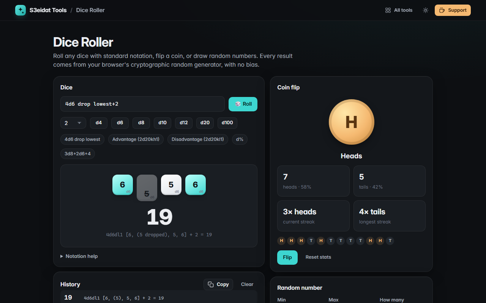

# Dice Roller

> Roll dice with standard notation, flip a coin, or draw random numbers. Free, private, and it runs entirely in your browser.

### ▶ [Open Dice Roller](https://s3eidat.github.io/dice-roller/)



## Features

- **Dice notation**: <code>2d6+3</code>, <code>d20</code>, <code>3d8+2d6-1</code>, <code>d%</code>, and drop/keep: <code>4d6 drop lowest</code> (<code>4d6dl1</code>), <code>dh</code>, <code>2d20kh1</code> (advantage), <code>2d20kl1</code> (disadvantage)
- Quick buttons for d4, d6, d8, d10, d12, d20 and d100, with a dice count
- **Animated dice**: max rolls highlighted, ones in red, dropped dice faded; full breakdown of every roll
- **History** of your last 100 rolls (copy all)
- **Coin flip** with a 3D flip, heads/tails counts and percentages, current and longest streak
- **Random numbers** in any range, many at once, optional **no repeats** and sort
- **Fair**: every value comes from crypto.getRandomValues with rejection sampling, so there is no modulo bias

## Privacy

Your roll history and settings are saved only in your browser (localStorage). There is no server, no account, no analytics.
The page ships with a strict Content-Security-Policy (`connect-src 'self'`), so the browser
itself blocks any attempt to send data anywhere.

## Run it yourself

It's plain HTML, CSS and JavaScript with no build step:

```bash
git clone https://github.com/s3eidat/dice-roller
cd dice-roller
python -m http.server 8000
```

Then open http://localhost:8000.

## Support

If this saved you time, **[buy me a coffee ☕](https://s3eidat.github.io/coffee/)**. It keeps every tool free.

---

Part of **[S3eidat Tools](https://s3eidat.github.io/)**: 100+ free, private tools that run in your browser. MIT licensed.
